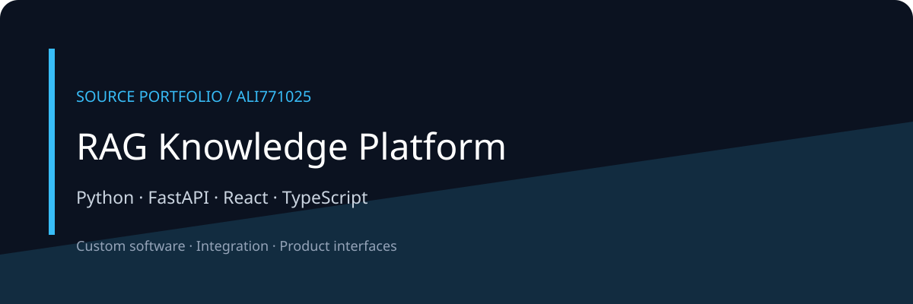

# RAG Knowledge Platform

<!-- project-contact:start -->
**Work with Yosof Omrani:** [Email a project inquiry](mailto:aliomrani916@gmail.com) · **aliomrani916@gmail.com** · [Services & contact](https://ali771025.github.io/software-portfolio/en/contact/) · [Portfolio walkthrough](https://ali771025.github.io/software-portfolio/en/work/rag-knowledge-platform/)
<!-- project-contact:end -->




A FastAPI and React source portfolio for document ingestion, retrieval, conversation and knowledge graph workflows.

[معرفی فارسی](docs/README.fa.md) · [Architecture](docs/ARCHITECTURE.md) · [Discuss a project](https://github.com/Ali771025)

## What this portfolio shows

- Backend modules separate ingestion, retrieval, graph knowledge and conversation memory.
- Frontend organizes workspaces, features, state and reusable components.
- Provider, database and task integrations are visible as source-level extension points.

## Technology

Python · FastAPI · React · TypeScript

## Local orientation

These are source-derived starting commands, not a verified deployment recipe. Review configuration and dependencies first.

```bash
cd backend
python -m venv .venv
source .venv/bin/activate
pip install -r requirements.txt
uvicorn app.main:app --reload
# In another terminal:
cd frontend
npm ci
npm run dev
```

All credentials, infrastructure and datasets must be supplied independently. See configuration modules for required variables. Binary assets and customer documents are deliberately absent; some visual asset references may need replacements.

## Edition and verification

This is a compact public source edition. Original history, contracts, private documents, databases, logs, generated output and dependency directories are excluded. No build, test, deployment, security certification or production-readiness claim is made for this edition. Public documentation and diagrams describe source structure; they are not application screenshots.

## Work together

For a related product, integration or custom workflow, [contact Ali through GitHub](https://github.com/Ali771025). Share your intended users, workflow and integration needs to scope the work.

No new license grant is added by this portfolio edition. Third-party components remain subject to their own terms.
