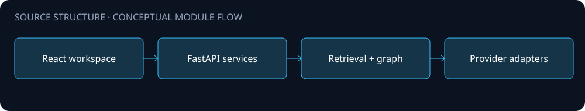
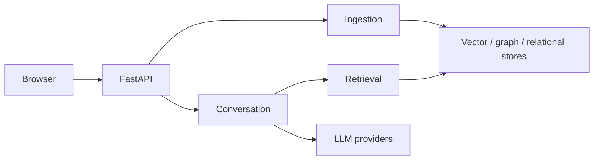

# Architecture

A FastAPI and React source portfolio for document ingestion, retrieval, conversation and knowledge graph workflows.

The diagram is a source-level orientation. Arrows describe intended module relationships; integration availability and end-to-end behavior were not validated for this public edition.

## Boundaries

- Backend modules separate ingestion, retrieval, graph knowledge and conversation memory.
- Frontend organizes workspaces, features, state and reusable components.
- Provider, database and task integrations are visible as source-level extension points.

## Configuration and data

Configure your own environment and service endpoints. Never place API keys, production connection strings, customer records or uploaded documents in this repository. Public source omits operational assets and does not include a production deployment guarantee.
